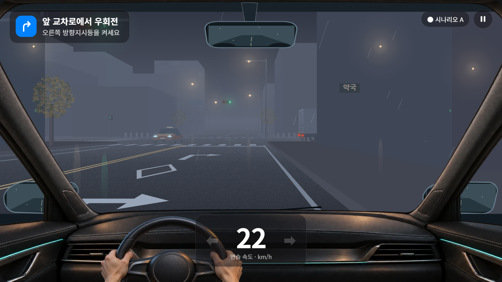
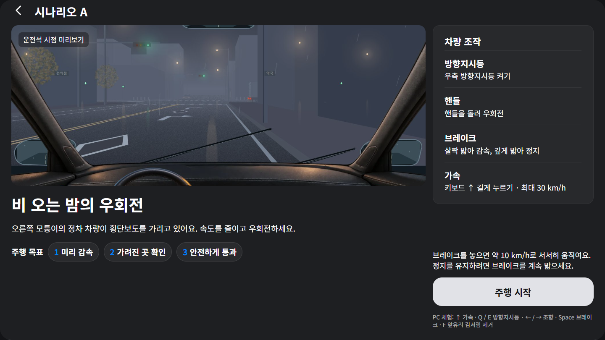
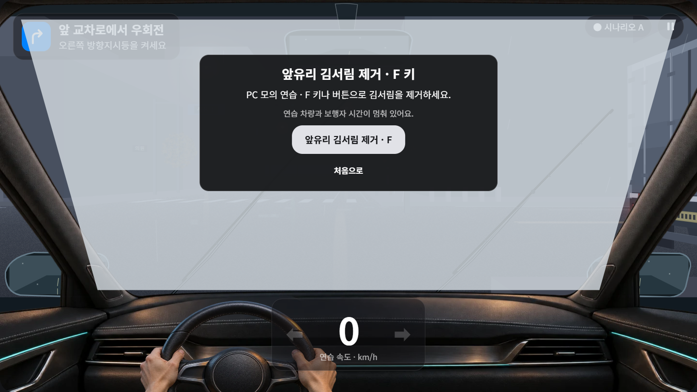
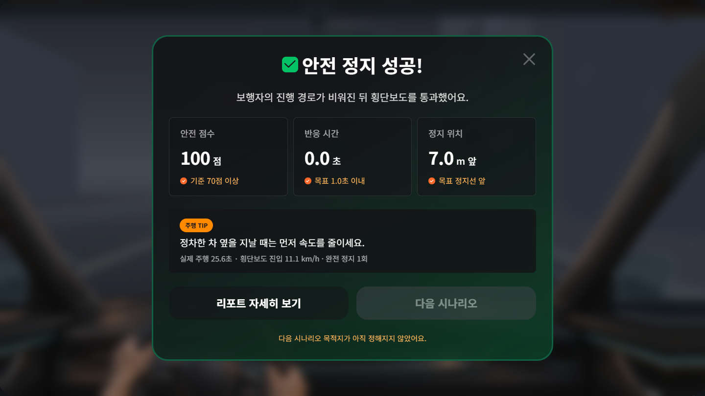
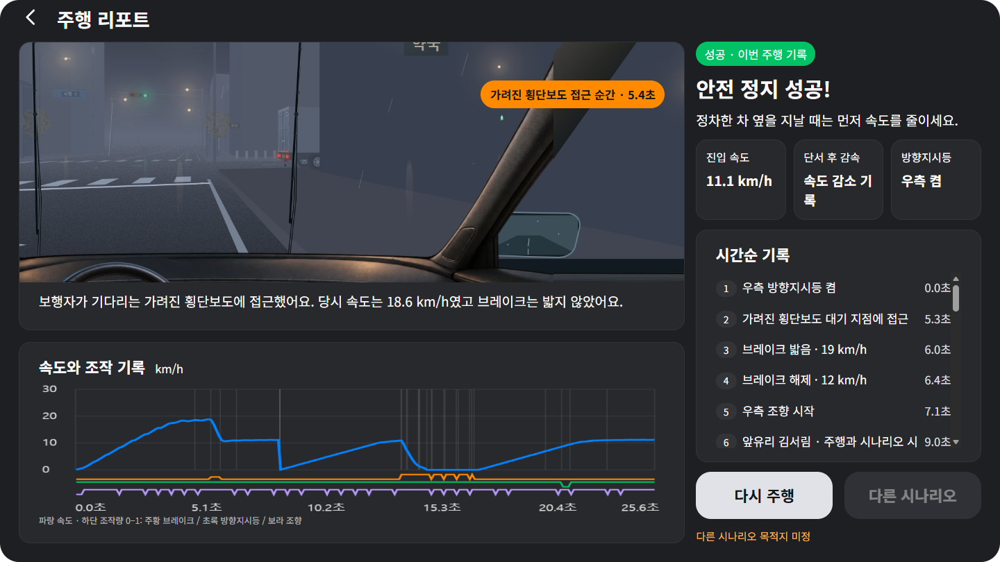

# 비 오는 밤의 우회전

> **Pleos Connect 공모전 출품작**
> 초보 운전자가 주차 중인 차 안에서 실제 핸들, 브레이크, 방향지시등으로 우회전 위험 상황을 미리 연습하는 위험 예측 훈련 앱입니다.



## 왜 만들었나요

우회전할 때 정차 차량에 가려진 횡단보도에서 보행자가 갑자기 나오는 사고는 ADAS가 미리 막기 어렵습니다. 운전자가 위험을 **미리 예측하고 속도를 줄이는 습관**이 필요합니다.
하지만 초보 운전자가 이런 상황을 실제 도로에서 연습할 방법은 없습니다.

이 앱은 차가 **P단에 서 있을 때만** 실행됩니다. 그 상태에서 실제 차량의 조작 장치로, 시야가 나쁜 밤 교차로 우회전을 반복해서 연습할 수 있습니다.

## 핵심 기능

- **실제 차량으로 조작:** Pleos Vehicle SDK로 실제 핸들 각도, 브레이크, 방향지시등을 읽어 게임 차량을 움직입니다.
- **P단 전용 안전 설계:**
  - P단이 아니거나 기어를 알 수 없거나 플랫폼이 주행 중 제한을 걸면 즉시 차단합니다.
  - 기어는 1초마다 다시 확인하고, 앱(네이티브)과 게임(웹)이 이중으로 막습니다.
- **가려진 위험 연출:**
  - 보행자는 정차 차량 뒤에 가려져 있다가 운전자가 대비하기 어려운 순간에 나옵니다.
  - 짙은 안개가 먼 곳을 가립니다.
  - 보행자가 나오지 않는 함정 회차도 섞여 있습니다.
- **앞유리 김서림 제거 연습:** 우회전 직전에 김이 서리면 실제 차량의 앞유리 디프로스터를 켜야 다시 출발할 수 있습니다.
- **결과와 리포트:**
  - 안전 점수, 반응 시간(목표 1.0초), 정지선까지 거리로 결과를 보여 줍니다.
  - 단서가 나타난 순간의 장면, 속도와 조작 그래프, 시간순 기록도 함께 보여 줍니다.

## 화면

| 브리핑 | 김서림 제거 연습 |
|---|---|
|  |  |
| **결과** | **주행 리포트** |
|  |  |

화면은 PC 브라우저 실행 화면입니다. 김서림 화면의 "PC 모의 연습" 표시는 차량이 없는 PC에서만 나옵니다.

## 공모전 제출 정보

| 항목 | 내용 |
|---|---|
| 앱 이름 | 비 오는 밤의 우회전 |
| 플랫폼 | Pleos Connect (Android, minSdk 28 / targetSdk 35) |
| 사용 SDK | Pleos Vehicle SDK 2.3.2: 기어, 조향각, 브레이크 페달, 방향지시등 읽기 / 앞유리 디프로스터(HVAC) 조회와 켜기 |
| 플랫폼 API | AAOS `CarUxRestrictionsManager` (주행 중 제한 감지) |
| 권한 | `pleos.car.permission.CAR_DRIVE`, `CAR_LIGHTS`, `CAR_CLIMATE`, `CONTROL_CAR_CLIMATE` |
| **APK 위치** | [p-안전코치.apk](apk/p-안전코치.apk) (서명된 release 빌드) |

### 실행 방법

**APK로 바로 실행**
1. Pleos Connect Emulator v2.1.0(Android API 34)을 Cold boot로 실행합니다. 설치 방법은 [android/README.md](android/README.md)에 있습니다.
2. `adb install -r "apk/p-안전코치.apk"`로 설치하고, 앱 목록에서 "비 오는 밤의 우회전"을 실행합니다.
3. 기어가 **P**일 때만 게임이 열립니다.
4. Virtual Console에서 기어, 브레이크, 조향각, 방향지시등을 바꿔 조작합니다. 먼저 `adb forward tcp:8088 tcp:8088`을 실행한 뒤 http://127.0.0.1:8088/ 의 Motion 메뉴를 엽니다.

**PC에서 바로 체험**
- `dist/index.html`을 Chrome에서 열면 키보드로 체험할 수 있습니다. 차량 없이 주차 상태로 가정합니다.
- 조작 키는 다음과 같습니다.
  - ↑ 가속, Space 브레이크
  - ← / → 조향
  - Q / E 방향지시등
  - F 앞유리 김서림 제거

**소스에서 빌드**
1. Node.js 18 이상에서 `node build.mjs`를 실행하면 `dist/index.html`이 생성됩니다.
2. Android Studio에서 `android/` 폴더를 열고 Run을 누릅니다. 빌드할 때 웹 게임이 APK 에셋으로 자동 포함됩니다.
3. 프로젝트 경로에 한글이 있으면 Android 빌드가 거부됩니다. `C:\dev\pleos-driving-game`처럼 영문 경로에 두세요.

### 테스트 환경

| 항목 | 버전 |
|---|---|
| 개발 PC | Windows 11, JDK 17 이상(Android Studio 내장 JBR 21), Node.js 18 이상 |
| 빌드 도구 | Android Gradle Plugin 8.8.2, Gradle 8.10.2, Kotlin 2.0.0, compileSdk 35 |
| 차량 환경 | Pleos Connect Emulator v2.1.0 (API 34) + Virtual Console |
| 일반 에뮬레이터 | Android 폰 에뮬레이터 (디버그 빌드의 모의 차량 모드: 주차 상태로 가정, 터치 조작) |
| 웹 단독 실행 | Chrome에서 `dist/index.html` (키보드 조작) |

## 구조

```
[Pleos 차량]  Vehicle SDK (기어·조향·브레이크·방향지시등·공조) / AAOS Car API (주행 중 제한)
      ▼
[호스트 앱 · Kotlin]  VehicleBridge · DefrosterController · UxRestrictionsSource · MainActivity
      │  evaluateJavascript → window.MCER.Pleos.receive({type, ...})
      │  ▲ window.PleosHost.ready() / defrostFront() / practiceState()
      ▼
[게임 · WebView]  input.js(입력) → drive.js(물리·판정) → scene.js(렌더링) → app.js(화면·리포트)
```

| 폴더 | 내용 |
|---|---|
| `android/` | Kotlin 호스트 앱 (차량 SDK 연동, 안전 차단, WebView) |
| `web/` | 게임 소스 (HTML, CSS, JavaScript, 이미지) |
| `dist/` | 빌드된 단일 HTML. APK에 포함되는 파일입니다 |
| `tests/` | 입력, 물리·판정, UI, 김서림, 렌더링, WebView 검사 |
| `docs/` | README 화면 캡처 |

---

# 기술 문서

아래는 빌드, 연동 규격, 검증 기록 등 개발자용 상세 내용입니다.

## 웹 게임 빌드

Node.js 18 이상에서 프로젝트 폴더를 열고 아래 명령을 실행합니다. 별도의 패키지 설치가 필요하지 않습니다.

```sh
node build.mjs
```

생성된 `dist/index.html`을 브라우저에서 직접 열 수 있습니다. 개발 중에는 `python3 -m http.server 8000`을 실행하고 `http://localhost:8000/web/`에서 분리된 소스를 확인합니다. 배포용 HTML은 스크립트, 스타일, 이미지가 모두 포함돼 있습니다.

데스크톱에서는 `↑`로 가속, `Q` / `E`로 방향지시등, 좌우 화살표로 조향, `Space`로 브레이크, `F`로 앞유리 김서림 제거를 조작합니다. 페달 입력이 없으면 D단 크리핑처럼 약 10 km/h로 천천히 움직이고, `↑`를 누르면 최대 30 km/h까지 가속합니다. 브레이크를 밟고 있는 동안에만 완전히 정지합니다. `Shift+P`로 주차 상태를 모의 전환할 수 있습니다. URL에 `?touch=1&diag=1`을 붙이면 터치 조작과 성능 진단이 표시됩니다. `quality=high|medium|low`로 시작 품질을 선택합니다. 화면 비율이 바뀌면 주행 화면을 16:9로 맞춰 배치합니다.

## Android 호스트에 넣기

1. `node build.mjs`로 `dist/index.html`을 만듭니다. Android 빌드가 `syncWebGame` 작업으로 게임을 APK의 `assets/web/index.html`에 포함합니다.
2. 호스트에서 WebViewAssetLoader의 `/assets/` 경로를 등록하고, JavaScript를 활성화한 WebView에서 `https://appassets.androidplatform.net/assets/web/index.html`을 엽니다.
3. HTML을 로드하기 전에 호스트의 `PleosHost.ready()`를 노출합니다. 이 호출을 받으면 호스트가 읽기 권한, 현재 차량 입력, UX 제한, 주차 상태를 `window.MCER.Pleos.receive(message)`로 보냅니다. 최초 주차 상태가 오기 전에는 게임이 차단됩니다.
4. SDK 입력은 호스트에서 capability 확인과 권한 처리 후 읽기 이벤트만 전달합니다. WebView의 허용 URL을 앱 에셋으로 제한하고, 차량 입력 연결 및 주차 제한 검증은 호스트에서 수행합니다.

`receive`는 객체나 JSON 문자열을 받습니다. 메시지 타입은 `capabilities`, `turnSignal`, `steeringAngle`, `brakePedal`, `acceleratorPedal`, `uxRestrictions`, `parked`, `defroster`입니다. `READ`와 `READ_WRITE`인 입력만 게임이 사용합니다. 브레이크는 SDK의 불리언 신호를 0 또는 1로 처리하고, 미지원 입력은 터치로 조작합니다. Vehicle SDK에는 가속 페달 읽기 API가 없으므로 가속은 키보드 `↑`로만 받습니다. 페달 입력이 없으면 약 10 km/h로 크리핑합니다. 호스트가 숨겨진 동안에는 렌더링과 시뮬레이션을 멈춥니다. 현재 게임에는 오디오 재생 코드가 없습니다.

테스트 훅(`window.__game`)은 브라우저에서 직접 열 때와, 앱이 `?hooks=1`로 열 때(Android 디버그 빌드)만 생깁니다. 릴리스 앱에는 없습니다. 테스트 훅은 `window.__game.getState()`, `setTurnSignal('OFF'|'LEFT'|'RIGHT')`, `pleos(message)`, `composition()`, `simulate(seconds, input)`, `stats()`입니다. `simulate`는 화면을 그리지 않고 주행만 진행시킵니다. `stats()`의 GL 정보는 별도 WebGL 2 기능 확인 결과입니다. 실제 렌더러는 Canvas 2D입니다.

| 항목 | 구현 및 로컬 검증 | Pleos에서 남은 검증 |
|---|---|---|
| 에셋 번들 | 단일 HTML 생성, CSS·JS·WebP 인라인 | WebViewAssetLoader 경로에서 실제 로드 |
| 입력 | 키보드·터치·게임패드·호스트 메시지 정규화, 모의 호스트로 권한과 입력 검증 | SDK 구독, 권한 팝업, 실물 조작값 |
| 주차 제한 | 모의 호스트로 최초 대기, P 이탈, UX 제한과 재개 검증 | CarUxRestrictionsManager 및 플랫폼의 앱 차단 정책 |
| 화면 | 4:3~3:1 컨테이너에 16:9 화면 맞춤, 픽셀 제한과 품질 진단 | 에뮬레이터 분할 화면, 프레임 및 터치 사용성 |

## Pleos 실행 및 입력 재시험

1. JDK 17을 사용해 저장소 루트에서 `node build.mjs`를 실행합니다.
2. `android/`에서 `gradlew.bat :app:assembleDebug`를 실행합니다. 출력은 `android/app/build/outputs/apk/debug/app-debug.apk`입니다.
3. Device Manager에서 Pleos Connect v2.1.0 전용 API 34 이미지의 AVD를 Cold Boot로 실행합니다. 현재 테스트 AVD 이름은 `Pleos_Connect_v2.1.0_API34`입니다.
4. 디버그 APK를 Pleos AVD에 설치한 뒤 `adb -s <기기번호> forward tcp:8088 tcp:8088`을 실행하고 `http://127.0.0.1:8088/`에서 차량 입력을 시험합니다.

2026-11-11 로컬 재시험은 Pleos AVD 한 대와 Vehicle SDK 2.3.2로 진행했습니다. 아래 시간은 Virtual Console 자동 조작 시작부터 게임의 입력 처리 로그가 PC에 도착할 때까지의 근사치이며, 자동화와 로그 전달 시간이 포함됩니다.

| 입력 | 1회 | 2회 | 3회 | 중앙값 |
| --- | ---: | ---: | ---: | ---: |
| P → D 주행 차단 | 0.75초 | 2.32초 | 0.52초 | 0.75초 |
| 조향 0° → +250° | 1.33초 | 0.80초 | 3.21초 | 1.33초 |
| 브레이크 누름 | 1.36초 | 2.57초 | 2.32초 | 2.32초 |
| 브레이크 해제 | 2.04초 | 1.49초 | 1.87초 | 1.87초 |
| 우측 방향지시등 메시지 수신 | 0.48초 | 2.70초 | 3.49초 | 2.70초 |

D단 메시지 처리 시 주차 제한이 표시됐고, D단을 유지한 채 1.2초 뒤에도 주행 시간은 4.45초였습니다. P단 복귀 후 주차 제한이 해제됐습니다. 우측 방향지시등은 세 번 모두 수신됐으며, Pleos 후측방 카메라가 게임을 가려 화면 반영 시간은 측정하지 못했습니다. 실시간 입력 판정은 보류입니다.

서명 전 릴리스 빌드는 `gradlew.bat :app:assembleRelease`로 확인했습니다. 최종 서명과 제출 APK 검증은 팀 앱 ID, 아이콘 및 서명 키 확정 후 진행합니다.

## 시나리오 A 구성

- 정차 차량은 우회전 직후 모퉁이 연석에 서 있고(`Drive.parked`), 횡단보도는 그 차량 바로 앞에 있습니다(`Drive.crosswalk`). 차량 옆을 지나는 운전자에게는 차량 앞 인도에서 내려서는 보행자가 보이지 않습니다.
- 보행자는 처음부터 정차 차량 뒤 인도에서 가려진 채 기다립니다. 차가 단서 지점(`cueDistance`)을 지난 뒤 최소 4.6초(`revealDelay`)를 기다렸다가, 차가 횡단보도까지 약 2.8초(`stepLead`) 남았을 때 차량 앞으로 나옵니다. 차가 오지 않아도 `patience`초 뒤에는 건넙니다. 반응 시간은 보행자가 나온 순간부터 잽니다.
- 단서는 횡단보도 위로 먼저 드리우는 그림자와 차량 앞 모서리 밖으로 먼저 나오는 우산입니다.
- 감속 없이 지나가거나 서행만 하고 멈추지 않으면 `unsafe`, 보행자가 나온 뒤 멈춰 기다리면 `safe`입니다.
- 함정 버전(보행자가 나오지 않는 회차)에서는 서행 통과가 정답이고, **불필요한 급제동**은 횟수만큼 감점합니다. 실제 차의 브레이크는 밟음/뗌만 읽히므로, 페달의 세기가 아니라 한 번 밟아서 차에 생긴 변화로 판정합니다. 횡단보도 8 m 앞부터 3 m 지난 곳 사이에서, 시속 12 km 이상일 때 밟아 그 한 번에 시속 8 km 이상 줄이면 급제동입니다. 회전 전에 미리 감속하거나 가볍게 끊어 밟는 것은 감점하지 않습니다.
- 실제 핸들 각도는 450°를 최대 조향으로 바꿉니다(±2° 무시). 차량마다 다르면 `?steerLock=<도>`, 방향이 반대면 `?steerSign=-1`로 맞춥니다.

## 주행 보정

- 키보드·터치 조향은 누르는 동안 핸들이 점진적으로 감기고, 놓으면 중앙으로 돌아옵니다. 차량·게임패드의 아날로그 조향값은 그대로 사용합니다.
- 교차로 안에서 곡률은 조향 명령을 거리 기준으로 따라가고, 차가 90도에 가까워지면 스스로 풀립니다. 우회전 뒤에는 차로 유지 보정이 출구 주행선으로 부드럽게 맞춥니다.
- 우회전 주행선은 반경 5 m이며 정차 차량의 왼쪽(`Drive.track.exitLane`)으로 지나갑니다. 교차로 시작 위치는 이상적인 주행선이 출구 주행선에 정확히 닿도록 `drive.js`가 계산합니다.
- 조향하지 않으면 차량과 기본 시점은 직진을 유지합니다. 실제 우회전이 시작된 뒤에만 시선이 오른쪽 인도 또는 정차 차량 앞 틈 쪽으로 향합니다(`scene.js`의 `interest`).
- 방향지시등을 켜면 시선이 그쪽으로 잠깐 돌아갔다가 전방으로 돌아옵니다. `scene.js`의 `glanceTime`, `glanceRest`로 조절하며, `glanceRest`를 1로 두면 지시등이 켜진 동안 계속 그쪽을 봅니다.
- 주행 로직은 `node tests/drive.cjs`로 검증합니다.

## 장면 렌더링과 성능 확인

- 화면 밖의 형상 묶음을 투영 전에 제외하고, 면별 좌표 버퍼·차량 형상·실내 Path2D·고정 그라디언트를 재사용합니다.
- 시야 제한은 짙은 안개로 표현합니다. 거리별 안개 색은 40단계로 미리 계산해 캐시하므로 매 프레임 추가 비용이 없습니다. 농도는 `scene.js`의 `FOG`로 조절합니다. 보행자는 안개 속에서도 32% 이상 보이게 해 훈련 단서를 남깁니다.
- 가로등·신호등·차량 불빛의 번짐과 젖은 도로의 반사는 한 번 만든 작은 이미지를 재사용합니다. 장면 복사, 굴절, 블룸, 미러 재렌더링은 사용하지 않습니다.
- 기기가 느리면 처음 몇 초 안에 화질을 high, medium, low 순으로 자동으로 낮춥니다.
- 옅은 이슬비와 기존 궤적·주기의 와이퍼 날을 유지합니다. 카메라, 보행자 투영·가림, 차량 입력과 안전 판정은 같은 계산을 사용합니다.
- 브라우저 검증은 Node.js 22 이상과 Chrome에서 `node tests/scene.cjs`로 실행합니다. 다른 Chrome 경로는 `CHROME_PATH` 환경변수로 지정합니다.
- `node tests/scene.cjs <변경 전 scene.js 경로> --demo`는 의도적인 효과 차이를 기록하고, 안전 주행 중 매 프레임의 카메라·보행자 가림 영역·와이퍼·제동 및 결과 기록이 일치하는지 검사합니다. `--demo` 없이 이전 소스를 주면 엄격한 이미지 비교를 사용합니다. 결과와 스크린샷은 `android/app/build/renderer-report/`에 저장합니다. 화면 크기 변경과 초기화도 검사합니다.
- Pleos 디버그 WebView를 `adb forward tcp:9223 localabstract:webview_devtools_remote_<앱 PID>`로 연결한 뒤 `node tests/pleos-demo.cjs before off 30` 또는 `after on 30`으로 앱의 실제 RAF 간격을 기록합니다. 해상도 비교를 위해 품질 변경만 고정하고, 같은 키 입력과 테스트용 차량 메시지를 사용합니다. 최초 2초와 리포트·재시작 경계는 제외하며 평균 FPS, p95 간격, 50ms 초과와 1초 이상 간격을 `android/app/build/demo-report/`에 저장합니다. 데스크톱 `draw()` 시간과 기기 RAF 간격은 별도 지표입니다.

## 보안 설정

- **CSP**: `web/index.html`의 Content-Security-Policy는 개발용(같은 출처 파일만 허용)입니다. `node build.mjs`가 배포용 `dist/index.html`에서 이를 **인라인 스크립트·스타일의 SHA-256 해시만 허용**하는 정책으로 바꿉니다. 네트워크 요청, 다른 스크립트, 폼 전송은 모두 막힙니다. `web/`에 외부 리소스(폰트, CDN 등)나 HTML 인라인 이벤트(`onclick=` 등)를 추가하면 차단되니 주의하세요.
- **Android 릴리스**: R8로 앱 코드를 축소·난독화합니다(Pleos SDK는 그대로 보존). 크래시 분석용 `android/app/build/outputs/mapping/release/mapping.txt`는 릴리스마다 팀이 보관합니다.
- **차단 원칙(fail-closed)**: 기어·주행 규제 상태를 알 수 없게 되면(서비스 미연결, 리스너 실패, 값 없음) 게임을 막습니다.
